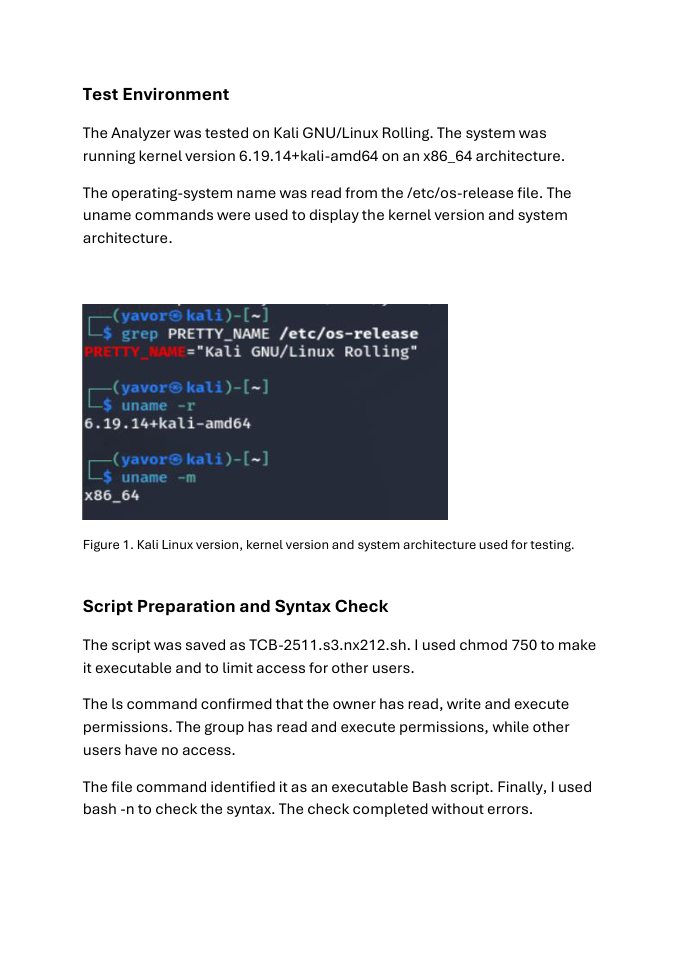

# Windows Forensics Analyzer

A Bash workflow that organizes disk-image extraction and Windows memory analysis into reports, tool logs and an optional ZIP archive.

Developed as ThinkCyber coursework by **Javor Mirchev**, with AI-assisted coding and report preparation. Laboratory setup, test execution and screenshots were carried out by the author.

## What it does

- Validates root privileges and input-file readability.
- Uses Bulk Extractor, Foremost, Binwalk and Strings for disk/file workflows.
- Uses Volatility 3 for supported Windows memory images, processes, network connections and registry hives.
- Compares SHA-256 hashes before and after analysis; the portfolio revision stops on a mismatch.
- Keeps partial output and records tool warnings instead of hiding them.

## Requirements

Kali Linux, Bash, GNU coreutils, file, binutils, bulk-extractor, foremost, binwalk, zip and Volatility 3.

The operational workflow was developed for a Linux laboratory. Windows/Git Bash is used only for the offline portfolio checks described below.

## Usage

Start with help, which performs no installation or network/deployment action:

```bash
bash scripts/analyzer.sh --help
```

Authorized laboratory workflow:

```bash
sudo bash scripts/analyzer.sh /path/to/authorized-image.img
```

## Evidence and validation



This is a selected historical report excerpt from the author's own laboratory. Historical filenames remain visible. It is not a screenshot of the portfolio revision being re-tested.

- [Laboratory evidence and provenance](docs/EVIDENCE.md)
- [Current offline validation and its limits](docs/VALIDATION.md)
- [Authorship and AI assistance](docs/AUTHORSHIP.md)

Run the local automated checks without an assessment target:

```bash
bash -n scripts/analyzer.sh
shellcheck scripts/analyzer.sh
python3 -m unittest discover -s tests -v
```

The included GitHub Actions workflow runs these offline checks after publication. No remote CI result is claimed before it runs.

## Limitations and handling of output

- Memory detection and registry dumping depend on Volatility 3 support, symbols and readable memory pages.
- Some extraction tools can fail or produce partial artifacts; inspect their individual logs.
- An initial/final hash comparison checks for changes during this run; it is not a complete forensic chain-of-custody process.
- Normal execution may install missing packages. Forensic output can contain recovered passwords and personal data; do not commit it.

## Portfolio revision

The original coursework script remains unchanged in the author's local source folder. This repository uses a readable script name and includes the following limited changes:

- Added side-effect-free help and a source guard for testing.
- An integrity mismatch or hash-read failure now returns an error before a success archive is created.

The full original reports, raw assessment results, credential files and course assignment briefs are not distributed here. No open-source license is included, by the author's choice.
